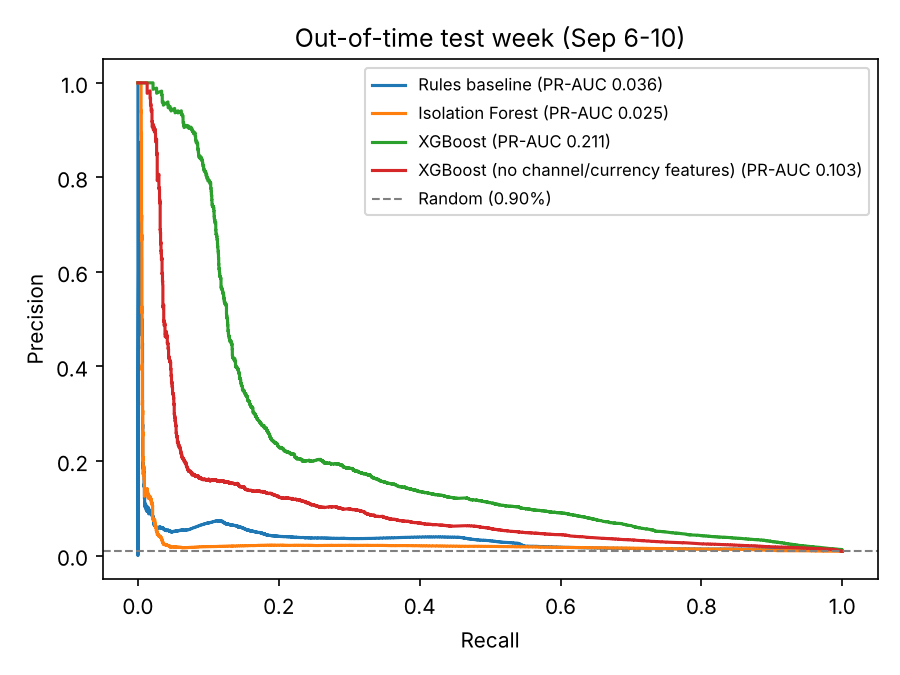
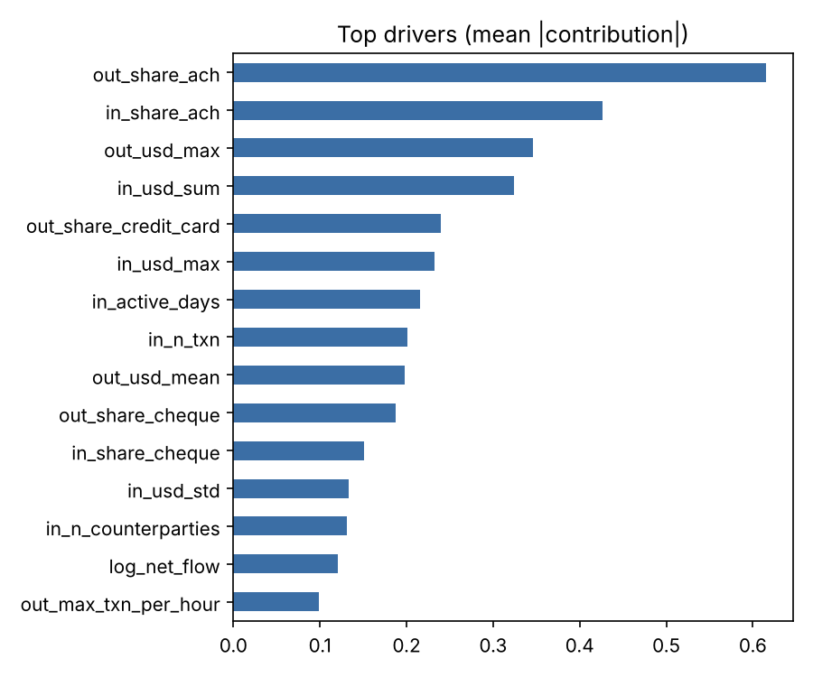

# AML Alert Triage: ML Detection + LLM Case Summaries

Ranks bank accounts by money-laundering risk with supervised and unsupervised models, then uses an LLM to turn each high-risk alert into a short case summary an investigator can read, with a check that flags hallucinated numbers.

📓 **[Full walkthrough notebook with code and results](aml_project.ipynb)**

## Problem

- Transaction monitoring systems generate many alerts, and most of them are false positives
- Investigators can only review a limited number of alerts, so **ranking quality in the top of the queue** matters more than overall accuracy
- Each alert still needs a write-up explaining why it was flagged, which takes analyst time

## Data

- [IBM Transactions for Anti Money Laundering](https://www.kaggle.com/datasets/ealtman2019/ibm-transactions-for-anti-money-laundering-aml), `HI-Small_Trans.csv`: synthetic bank transactions generated by a multi-agent simulator, with laundering transactions labelled
- 5.08M transactions over Sep 1-10, 2022 (the sparse tail after Sep 10 is dropped), 15 currencies, amounts converted to USD
- Laundering rate: **0.09% of transactions**, 0.69% to 0.90% of accounts per week

## Approach

1. **Account-level features** (39) per week: volume and amounts, fan-in / fan-out (distinct counterparties and banks), pass-through ratio (money in vs out), payment channel mix, currency switching, bursts (max payments per hour)
2. **Out-of-time split**: train on Sep 1-5, test on Sep 6-10, mirroring deployment on next week's activity
3. **Models**
   - Rules baseline: red-flag scorecard, like traditional rule-based monitoring
   - Isolation Forest: unsupervised anomaly detection, no labels
   - XGBoost: supervised, `scale_pos_weight` for class imbalance, early stopping on PR-AUC
4. **Explainability**: per-account feature contributions (XGBoost `pred_contribs`, equivalent to TreeSHAP) give the top drivers for each alert
5. **LLM case summaries**: an evidence pack (score, drivers, account profile, transactions) goes to Claude with a grounded prompt, and a faithfulness check verifies that every number in the output traces back to the evidence

## Results (test week, 372,889 accounts, 0.90% positive)

| Model | PR-AUC | ROC-AUC | Precision@100 | Precision@500 | Recall@1000 |
|---|---|---|---|---|---|
| Rules baseline | 0.036 | 0.745 | 0.23 | 0.10 | 0.022 |
| Isolation Forest | 0.025 | 0.690 | 0.24 | 0.12 | 0.022 |
| **XGBoost** | **0.211** | **0.904** | **0.98** | **0.73** | **0.133** |
| XGBoost without channel/currency features | 0.103 | 0.847 | 0.88 | 0.34 | 0.062 |



Takeaways:
- In the top 500 alerts, XGBoost is right 73% of the time vs a 0.90% base rate, about **80x better than random** and 7x better than the rules baseline
- Isolation Forest barely beats random: laundering accounts here are not statistical outliers, they look like ordinary small accounts. Unsupervised methods find "unusual", which is not the same as "suspicious"
- **Ablation**: removing payment-channel and currency features halves PR-AUC. The simulator ties laundering strongly to ACH and currency switching (no Wire transaction is ever labelled), so the full model's numbers are optimistic and would not transfer as-is to real bank data
- Top alerts share a clear pattern: all of the top 50 send money in 2 or more currencies, 94% send only via ACH, and most pay out to just 2 recipients, consistent with funds being moved across currencies (layering)



## LLM case summaries

`src/llm_summary.py` writes a summary for each top alert ([example output](outputs/case_summaries.md)). Design choices aimed at known LLM limitations:
- **Grounding**: the prompt allows only facts from the evidence pack and requires numbers to be quoted exactly
- **No verdicts**: the model must not imply guilt; an alert is a reason to review, not a finding
- **Faithfulness check**: every number in the generated text is matched against the evidence pack, and unmatched numbers are flagged as possible hallucinations
- **Fallback**: without an `ANTHROPIC_API_KEY`, a rule-based template writes the summary, so the pipeline always runs end to end

What the real run with Claude showed:
- **The LLM caught a data inconsistency in my own pipeline.** Profile features excluded self-transfers (an account exchanging currency with itself) while the transaction list included them, and Claude flagged the mismatch ("the profile lists 3 outgoing transactions, but 4 are shown"). The evidence pack now labels self-transfers explicitly
- **It surfaced patterns the features only hint at**, e.g. 15,362.86 USD received, exchanged to Yuan, and sent out as a Yuan payment worth exactly 15,362.86 USD the same day
- **The faithfulness check flags derived numbers too**: "about 16.5 hours" (00:26 to 16:53) is correct but computed, so it is flagged for a reviewer to confirm. The check is a triage aid for human review, not a guarantee

## Run it

Open `aml_project.ipynb` in Jupyter or VS Code and run all cells, or use the scripts:

```bash
pip install -r requirements.txt
python src/prepare_data.py data/HI-Small_Trans.csv   # ~1 min
python src/train.py                                  # ~2 min
export ANTHROPIC_API_KEY=...                         # optional
python src/llm_summary.py 5
```

## Limitations and next steps

- Synthetic data: patterns are cleaner than in real transactions, and there is no KYC or customer profile data
- Labels mark any account touching a laundering transaction, which mixes originators, mules and recipients
- Next steps: graph features (counterparty risk, cycles, multi-hop paths), threshold choice based on investigator capacity, and an LLM agent that can query transaction history while drafting the summary

## Repository structure

```
├── aml_project.ipynb     # end-to-end walkthrough with outputs
├── src/
│   ├── prepare_data.py   # load CSV, convert to USD, keep Sep 1-10
│   ├── features.py       # 39 account-level behavioural features
│   ├── train.py          # rules, Isolation Forest, XGBoost, ablation, metrics, alert queue
│   └── llm_summary.py    # evidence packs, LLM summaries, faithfulness check
└── outputs/              # metrics, figures, alert queue, case summaries, evidence packs
```
